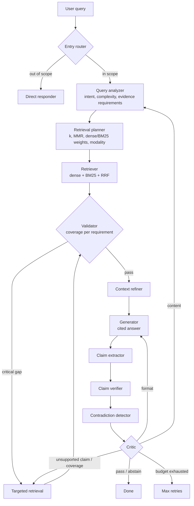

# AC-RAG: Evidence-Driven Adaptive RAG with Control-Step Budgeting

I built AC-RAG to answer a question I kept running into with ordinary RAG: **what happens when the retrieved evidence isn't enough, and nothing notices?**

Most RAG systems retrieve a fixed top-k, generate once and stop. AC-RAG is a [LangGraph](https://github.com/langchain-ai/langgraph) pipeline that turns the question into explicit evidence requirements, checks what it retrieved against them, re-retrieves only what's missing, verifies every generated claim against the source text, and then either answers or abstains. Every loop in the system shares one fixed step budget, so it always terminates.

The paper is in [`paper/main.tex`](paper/main.tex) (IEEE format). The short version of the result is below, and it's not the one I expected.

## What I found (the honest summary)

I compared the full pipeline against a naive single-pass RAG baseline on 120 questions over *Attention Is All You Need*, across 8 ablation configurations.

| Metric (N=120) | Baseline RAG | AC-RAG (full) |
|---|---|---|
| Composite quality | **0.4922** | 0.4832 |
| Faithfulness | 0.4437 | **0.4482** |
| Errors ("max retries exhausted") | **0** | 11 |
| Latency per query | **8.5 s** | 20.6 s |
| Cost per query | **$0.0015** | $0.0028 |

- **It does not beat the baseline on aggregate quality.** It's about 2.4x slower and 1.9x more expensive. I'm reporting that as is.
- **Five questions explain the whole gap.** In 5 of 120 cases the pipeline had already retrieved and validated the right evidence, then the generator/critic abstained anyway (a *false abstention*). Those five contribute -2.138 to the total composite delta of -1.080. The other 115 questions net **+1.058** in AC-RAG's favour.
- **The critic is the double-edged part.** Removing it cuts errors from 11 to 1 with almost no change in composite, but it's also the component meant to catch unsupported claims.
- **The benefit depends on the question.** On low-complexity lookups the extra machinery is wasted. It starts paying off on mid-complexity questions.
- **What I'd do next:** route by query complexity so the full loop only runs when it's worth it, and add a narrow guard for the "evidence already validated, but still abstained" case.

The value of the architecture, as I see it, is that failures become *diagnosable*: each one traces to a specific stage and reason.

## How it works



All nodes read and write one shared `ACRagState` (`pipeline/state.py`), and routing decisions live in one file (`pipeline/router.py`) so they can be unit tested.

| Stage | What it does |
|---|---|
| **Entry router** | Cheap check before any retrieval: dense similarity, then a BM25 fallback, then lexical heuristics. Out-of-scope queries get an "I don't know". |
| **Query analyzer** | One structured-output LLM call. Rewrites the query, scores complexity, and produces up to 6 typed *evidence requirements* (type, priority, keywords, expected modality). |
| **Retrieval planner** | Rule-based plan from complexity (k = 4 / 6 / 10), plus a small LLM refinement. Numeric lookups get a lexical boost; "how/why" questions get a dense boost. |
| **Retriever** | Hybrid dense (FAISS) + BM25, merged with Reciprocal Rank Fusion. |
| **Validator** | Scores every passage against every requirement (semantic, lexical, exact-number, modality signals) and computes coverage. Critical requirements are checked separately from overall coverage. |
| **Targeted retrieval** | Searches specifically for the keywords of whichever requirement is still missing, instead of re-running the original query. |
| **Context refiner** | Dedupes near-identical passages, but never drops one that uniquely covers an unmet requirement. |
| **Generator** | Answers only from the supplied context, with inline citations. |
| **Claim extractor / verifier / contradiction detector** | Splits the answer into atomic claims and checks each against the evidence. The verifier overrides the LLM's own labels with numeric thresholds and fails safe to `UNSUPPORTED` on error. |
| **Critic** | Scores five dimensions (1 to 5). Accepts, repairs (regenerate, targeted retrieval, or re-plan depending on the failure), or abstains. |

### Control-step budgeting

Every retry or re-retrieval increments one shared counter. Limits (in `config/settings.py`): 3 retrieval rounds, 2 generation repairs, 8 control steps in total. The system always ends in one of three loggable states: an accepted answer, an explicit abstention, or an explicit "max retries exhausted".

During evaluation I found a bug in my own router: the repair cap was never applied to the two most common failure reasons (`unsupported_claim`, `coverage`), so repair attempts reached 7 to 8 instead of 2 and some queries took over 180 s. The global cap hid it. It's fixed in `pipeline/router.py` and all reported numbers use the corrected logic. The paper has the full write-up.

## Project layout

```
pipeline/       LangGraph graph, router, shared state, and one file per node
  nodes/        query_analyzer, retrieval_planner, retriever, validator,
                targeted_retrieval, context_refiner, generator, claim_*,
                contradiction_detector, critic, entry_router
  retrieval/    BM25 retriever and dense/BM25 fusion (RRF)
ingestion/      loaders (PDF, DOCX, TXT, HTML, MD), chunking, table and figure extraction, metadata tagging
vectorstore/    FAISS index build and management
backend/        FastAPI app (upload + SSE streaming answers)
frontend/       React + Vite + Tailwind UI with a live per-agent pipeline view
evaluation/     ablation runner, metrics, test sets, public benchmark scripts
config/         all thresholds, budgets and ablation flags in settings.py
tests/          pytest suite for router, validator, critic, retriever, etc.
paper/          the paper (main.tex)
```

## Running it

You need Python 3.10+ and an OpenAI API key (the default provider). Switching `LLM_PROVIDER` in `config/settings.py` also supports Google, Anthropic and Groq.

```bash
python -m venv venv
venv\Scripts\activate            # Windows (use source venv/bin/activate on macOS/Linux)
pip install -r requirements.txt

cp .env.example .env             # then add your OPENAI_API_KEY
```

**Command line**

```bash
# put documents in data/raw/, then build the index
python main.py --build

# ask a question through the full pipeline
python main.py --pipeline "What is the dropout rate used for the big model?"
```

**Web UI**

```bash
# terminal 1: backend on http://127.0.0.1:8000
uvicorn backend.api:app --port 8000

# terminal 2: frontend (proxies /api to the backend)
cd frontend
npm install
npm run dev
```

Upload a document in the UI, ask a question, and you can watch each agent run, see its output, the evidence coverage, the claim checks and the critic scores.

**Evaluation**

```bash
python main.py --evaluate evaluation/test_set_1.json
python main.py --ablation evaluation/test_set_1.json   # all configurations
pytest tests/
```

The ablation configurations live in `evaluation/ablation.py`: `baseline_rag`, `full`, `no_planner`, `no_validator`, `no_refiner`, `no_critic`, `low_k`, `high_k` (plus a `critic_relaxed` variant I added later).

## Limitations

I'd rather list these here than have someone find them:

- The faithfulness threshold τ described in the paper exists in `settings.py` but isn't enforced in code. Accept/reject is decided by the critic and claim verification.
- My faithfulness metric is embedding similarity, a proxy for grounding, not true entailment.
- The evaluation paper is famous enough that GPT-4o-mini has probably seen it, so I trust relative comparisons between configurations more than absolute scores.
- No paired significance test, human evaluation or cross-provider run (API budget). The small question-type probes are descriptive only.
- A small SQuAD v2.0 side test (25 questions) showed a trade-off between false abstention and correct abstention, but with only 5 unanswerable questions I can't draw a firm conclusion.

## Tech stack

Python, LangGraph, LangChain, Pydantic structured outputs, FAISS, BM25, OpenAI (`gpt-4o-mini`, `text-embedding-3-large`), FastAPI with Server-Sent Events, React 18, Vite, Tailwind CSS, pytest.

## Authors

Department of Information Technology, Sagi Rama Krishnam Raju Engineering College, Bhimavaram. See the paper for the full author list.
